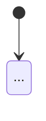
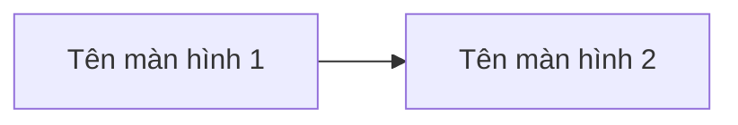

# Phạm vi chức năng & Sitemap

> Điền vào từng mục dưới đây dựa trên input (RFP, ghi chú họp, mô tả từ sales). Nếu một mục không có đủ thông tin trong input, ghi "*Chưa rõ — xem câu hỏi làm rõ*" thay vì bỏ trống hoặc suy đoán. Tách riêng khỏi `requirements-summary.md` vì đây là phần được estimating-effort và writing-proposal đọc trực tiếp, nhiều nhất và thường xuyên chỉnh sửa lại theo diễn biến trao đổi với khách hàng.

## Phạm vi & yêu cầu chức năng
- Mô tả tổng quan phạm vi:
- Danh sách chức năng/module chính:
- Các hạng mục nằm ngoài phạm vi (nếu khách hàng có nêu):

## Phân tích đối tượng nghiệp vụ & vòng đời
> Với mỗi chức năng ở mục trên có quản lý một đối tượng dữ liệu riêng biệt (bỏ qua chức năng loại xem/báo cáo không sở hữu dữ liệu riêng), xác định đối tượng đó, độ lớn và vòng đời. Đây là căn cứ chính để `estimating-effort` chọn mức độ phức tạp — dùng thay cho việc đoán theo tên chức năng.

| # | Đối tượng (Entity) | Thuộc chức năng/module | Số trường ước tính | Vòng đời / trạng thái chính | Ràng buộc đặc thù | Ghi chú độ phức tạp gợi ý |
|---|---|---|---|---|---|---|
| 1 | | | Ít (<10) / Vừa (10-20) / Nhiều (>20) | | | |

- Tổng số đối tượng nghiệp vụ đã xác định (ghi "*Không có đối tượng nghiệp vụ riêng*" nếu chức năng toàn bộ là xem/báo cáo):

## Đối tượng sử dụng & nhiệm vụ
> Với danh sách chức năng ở trên, xác định các vai trò người dùng cuối sẽ trực tiếp sử dụng hệ thống và nhiệm vụ chính của từng vai trò — khác với bảng "Vai trò & trách nhiệm hai bên" ở `requirements-summary.md` (đó là trách nhiệm giữa HBLAB và khách hàng trong dự án, còn đây là vai trò NGƯỜI DÙNG CUỐI của phần mềm tương lai).

| # | Vai trò người dùng | Mô tả | Nhiệm vụ chính trong hệ thống | Thuộc chức năng/module liên quan |
|---|---|---|---|---|
| 1 | | | | |

- Tổng số vai trò người dùng đã xác định (ghi "*Không xác định được vai trò người dùng riêng biệt*" nếu chưa đủ thông tin):

## Danh sách màn hình & Sitemap
> Dựng dựa trên danh sách chức năng ở mục trên: mỗi chức năng thường cần ít nhất 1 màn hình chính và có thể thêm màn hình quản lý/form. Đây là bản dựng thảo (draft) để người dùng xác nhận, thêm hoặc bớt — không phải bản thiết kế chi tiết cuối cùng. Mục này phục vụ trực tiếp việc ước lượng effort ở bước sau (skill estimating-effort), nên cần có trước khi coi bản tóm tắt là hoàn chỉnh.
>
> Loại màn hình: *Màn hình chính* / *Màn hình quản lý* (danh sách, CRUD...) / *Pop-up dạng form* (tính vào tổng số) — hoặc *Pop-up thông báo/xác nhận* (KHÔNG tính vào tổng số, không cần liệt kê từng cái).

| # | Tên màn hình | Loại | Thuộc module/chức năng |
|---|---|---|---|
| 1 | | | |

- Tổng số màn hình tính vào ngưỡng độ phức tạp (Chính + Quản lý + Pop-up dạng form):

## Luồng nghiệp vụ chính (Workflow)
> Xác định 2-4 luồng nghiệp vụ chính nhất của dự án — danh sách này dùng chung cho cả `building-prototype` (quyết định màn hình nào có tương tác đầy đủ), không hỏi lại ở bước đó. Với mỗi workflow: vẽ state diagram nếu chức năng gắn với 1 đối tượng có vòng đời trong bảng "Phân tích đối tượng nghiệp vụ & vòng đời" ở trên, và luôn vẽ screen flow theo thứ tự màn hình tham chiếu bảng "Danh sách màn hình & Sitemap" ở trên.

### Workflow 1: <Tên workflow>
**Thuộc chức năng/module:** <tên chức năng>

**State diagram:**

*(hoặc ghi "Không áp dụng — chức năng không sở hữu đối tượng có vòng đời riêng" nếu không có đối tượng tương ứng, thay vì bịa state diagram)*

**Screen flow:**

- Tổng số workflow chính đã xác định:
